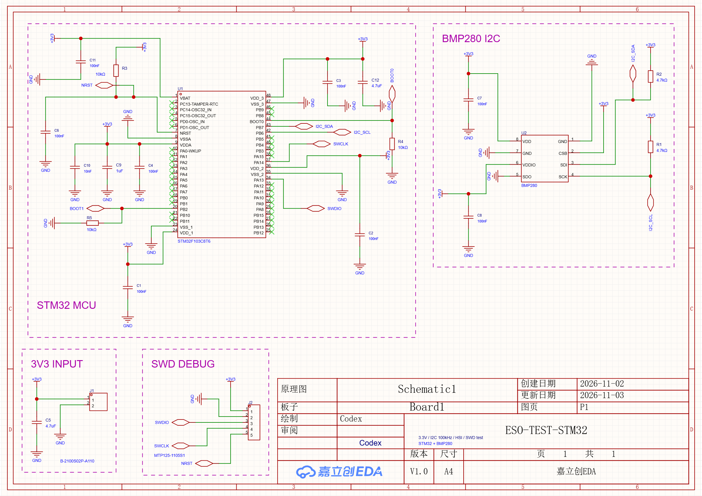

# EasyEDA Schematic Orchestrator

面向嘉立创 EDA 专业版的 AI 原理图绘制工作流。将需求、官方应用电路、通用知识库、设计确认、真实器件绘图和回读验收串成可追溯的流程。

**当前版本 0.5.1** · Python ≥3.10 · 本机 Skill + CLI · MIT

宿主 AI 负责理解需求、查阅资料和设计审阅，Python 执行确定性校验，
[easyeda-agent](https://github.com/zhoushoujianwork/easyeda-agent) 提供 CLI、daemon 与 EDA Agent Connector 绘图能力。
直接使用宿主模型，安装后即可运行离线流程。现场绘图还需配套的上游工具与 Connector。

[快速安装](#快速安装) · [开始设计](#开始设计) · [知识库](#常用电路知识库) · [检查与验收](#检查与验收) · [文档导航](#文档导航)

## 适合做什么

- 将自然语言需求整理为可确认的设计，包括供电、接口、选型、默认状态和验收范围。
- 获取所选模块的官方手册，以应用电路图为基线，按项目需求调整并记录依据。
- 复用嘉立创为核心的知识卡与原理图规范，核验已编码的参数、真实库身份和物理引脚。
- 在专用测试工程完成放置、布局、连接、保存重开与逐脚回读，并保留可复查的证据。
- 在放置中断后核对当前状态、补放缺件，使用实测文字恢复、布局候选比较与证据索引辅助收尾。

当前执行适配嘉立创 EDA 专业版，写入范围为 `ESO-TEST-*` 专用空白页及本轮创建的实例。
通用工作流和知识库可先安装、检索及离线验证，具体项目开始时再确定模块、型号和工况。

## 快速安装

### 交给 AI 安装

将下面的内容发送给 Codex 或支持本机命令与 Skill 的宿主 AI。

> 请读取 https://github.com/HXHakf/easyeda-schematic-orchestrator ，按根目录 AGENTS.md 和
> docs/AI-SETUP.md 安装完整 Skill。先检查 Python、eso、easyeda-agent 和已有 Connector，
> 复用兼容安装，运行离线烟雾测试，并分别报告离线能力、上游组件、现场连接和绘图验收状态。

### 手动安装

macOS / Linux，使用 Python ≥3.10，且支持 `venv` 与 `pip`。

```bash
git clone https://github.com/HXHakf/easyeda-schematic-orchestrator.git
cd easyeda-schematic-orchestrator
python3 scripts/install.py --dry-run
python3 scripts/install.py
"$HOME/.local/bin/eso" --version
```

Windows PowerShell，先确认 `py -3 --version` ≥3.10。

```powershell
git clone https://github.com/HXHakf/easyeda-schematic-orchestrator.git
cd easyeda-schematic-orchestrator
py -3 scripts/install.py --dry-run
py -3 scripts/install.py
& "$HOME\.local\bin\eso.cmd" --version
```

安装器部署完整 Skill、专用 Python 环境和命令入口，更新时保留旧 Skill 备份。
默认路径如下，命令入口也可直接使用完整路径运行。

| 内容 | 相对用户主目录的默认位置 |
|---|---|
| 完整 Skill | `.agents/skills/easyeda-schematic-orchestrator` |
| Python 环境 | `.local/share/easyeda-schematic-orchestrator/venv` |
| 命令入口 | `.local/bin/eso`，Windows 为 `eso.cmd` |

更新时在原 checkout 执行 `git pull --ff-only`，再重跑安装器。
完整 Skill 使用此安装器部署，单独安装 wheel 提供核心 CLI。
自定义路径、已有目录处理、上游安装和离线烟雾测试见[安装指南](docs/AI-SETUP.md)。

安装后可先检查本地能力与知识库。`doctor` 会分别列出通过、缺失和未检查项。

```bash
eso doctor
eso kb-check
eso kb-search '三极管低侧驱动'
```

## 开始设计

直接向宿主 AI 描述功能、所选模块和已知条件，例如“帮我画一个 STM32 最小系统”或
“使用我选好的模块画原理图，先核对官方应用电路”。选型尚未确定时也可以让 AI 协助选择。

```text
需求与选型 → 获取手册、审阅官方应用电路 → 匹配知识卡与参数核验
    → 中文设计确认 → 电路计划与真实库绑定
    → stage 放置 → collect 实测与布局 → prepare / dry-run
    → execute → verify 保存重开与回读 → deliver 证据交付
```

### 手册与设计依据

用户可以只提供型号和需求。宿主 AI 检索并下载缺少的官方手册，查看
Typical Application / Application Circuit / Reference Schematic 所在图页，
核对引脚表、供电条件、可选支路及脚注，保存来源、版本、内容哈希和页码／图号。
已有手册可直接提供，用于减少重复查找。

所选模块的官方应用电路是具体设计基线。成品模块先核对模块厂商接口、板载外围与原理图，
再补查底层芯片手册。修改阻容、接口、使能、保护或外围时记录原图依据和调整理由。
嘉立创知识卡补充通用方法，具体型号参数由对应官方资料核验。
获取与审图方法统一维护在[输入与官方应用电路指南](references/input-and-questions.md#官方手册与应用电路)。

### 确认与执行

宿主每轮最多提出三个需要用户决定的问题，能自行查到的手册和路径缺项先自行补齐。
正式绘图前生成中文 Design Contract，展示功能、型号、工况、设计依据、假设、目标页面与验收范围。
用户确认具体版本后进入执行，影响电路或目标的变更需要重新核验和确认。

宿主根据当前状态调用分阶段命令，核对测量、编译与回读结果。中断后先诊断并读取现场，
初始放置恢复使用 `recover-stage` 保留已有实例、补放缺件。
命令与证据要求见[工作流](docs/WORKFLOW.md)、[测量衔接](references/measurement-bridge.md)和[现场恢复](references/live-recovery.md)。

## 常用电路知识库

采用本地结构化知识卡与原始资料引用。六个主题均已登记嘉立创主来源，
按稳定主题 ID、别名和变体去重，资料来源集中登记，保存原创摘要与引用定位。

| 主题 | 当前支持 |
|---|---|
| NPN 低侧开关 | 静态电阻负载 `resistive-dc` 的参数校验与计划生成 |
| NMOS 低侧开关 | 静态电阻负载 `resistive-dc` 的参数校验与计划生成 |
| 电源防反接 | 知识卡、候选拓扑和审阅要点 |
| ADC 分压采样 | 知识卡、计算方法和检查要点 |
| GPIO LED 指示 | 知识卡、限流计算和错误反例 |
| I²C 开漏电平转换 | 知识卡、上拉规则和双 MOS 连接参考 |

知识卡包含适用条件、必要输入、连接关系、计算依据、物理脚核验要求、错误反例与来源。
NPN/NMOS 自动变体支持的条件和边界见[知识库使用指南](references/knowledge-base.md)。
项目资料可通过本机私有缓存复用，版本固定、条件覆盖、撤回和有限 MCU 组合见[资料复用与组合](references/knowledge-v2.md)。

内置确定性参考计划另包括 STM32F103C8T6 最小系统及 BMP280 压力／温度传感器。
其他电路由宿主依据所选模块资料编写 plan，再经过现有校验和执行链。
原理图规范以嘉立创为核心，使用 `eso rules --stage design`、`layout` 或 `verify` 查看对应阶段清单。
规则来源和检查器映射见[原理图设计规范](references/schematic-design-rules.md)。

## 检查与验收

各层检查按实际覆盖范围报告，电气论证、EDA 实现与实物性能分别记录。

| 层次 | 当前覆盖 |
|---|---|
| 资料与方案 | 文件哈希、资料身份、适用条件、依赖版本、物理脚绑定和确认失效 |
| 已编码电气规则 | NPN/NMOS 驱动、导通负载电流、关断条件及电压／电流／功耗／温度适用性，MCU 组合的 GPIO 占用、电平和电流预算 |
| EDA 实现 | 器件与物理脚／网络／NC 对账，原生严格 DRC、结构与几何检查，保存、重开和新鲜回读 |
| 图面审阅 | 结合实测文字、间距、模块归属及最新原生导出图，由工具和宿主完成审阅 |
| 项目电气验证 | 整机 SPICE、启动过程、通信时序、瞬态与实物测量尚待按具体项目接入和执行 |

功能条件检查能拒绝“额定值未超限，但不能达到声明负载电流”的已支持开关方案。
手册参数和推导必须覆盖声明工况，缺少证明时返回缺项。用户确认的工程假设记录在对应项目证据中。
测试方法与交付要求见[验收指南](references/verification.md)。

### 已有验证记录

- 软件发布记录包含 209 项主测试、71 项附加审计、三套离线演示和独立 wheel 探针。主测试为软件回归，真实上游离线集成为可选配置。[验证记录](docs/VALIDATION.md)
- CI 覆盖 Python 3.10 / 3.13 单元测试，以及 Linux、macOS、Windows 的独立安装、重复安装和安装后回归。[GitHub Actions](https://github.com/HXHakf/easyeda-schematic-orchestrator/actions/workflows/tests.yml)
- NPN/NMOS、MCU 双支路及受控缺件恢复样例已完成限定 EDA 现场验收，包含真实器件、保存重开、连接回读与图面复核，过程中的宿主修订保留在报告中。[开关样例](docs/plans/npn-nmos-eda-acceptance.md) · [组合样例](docs/plans/mcu-switch-eda-acceptance.md) · [恢复样例](docs/plans/recovery-live-acceptance.md)

现场已验证配套上游 v1.17.0。v1.16.0 存在十类／十一类快照兼容问题，
写前使用实际快照与离线编译探针核验兼容性。环境诊断、具体目标验收和历史结果分别报告。
版本与兼容细节见[安装指南](docs/AI-SETUP.md)和[上游研究记录](docs/RESEARCH.md)。

## 图纸预览



图中为 STM32F103C8T6 + BMP280，外部稳压 3.3V、I²C、SWD 和内部时钟，共 21 件器件、97 个物理脚。
此图来自下层 typed 链保存重开后的原生导出，其 ESO 标准链现场验收仍待完成。
图片来源、图面限制和验证范围见[效果图说明](docs/images/README.md)。

## 开发与离线验证

```bash
python3 -m venv .venv
source .venv/bin/activate
python -m pip install -e .
python -m unittest discover -s tests -v
python scripts/demo_workflow.py --out runs/offline-demo
python scripts/demo_knowledge.py --out runs/knowledge-demo
python scripts/demo_knowledge_v2.py --out runs/knowledge-v2-demo
```

Windows 可使用 `.venv\Scripts\python.exe` 运行相同 Python 命令。
演示使用合成资料生成待确认草稿，输出目录需为新目录。
设置 `EASYEDA_BIN` 为现有上游 CLI 的绝对路径，可运行额外的真实上游离线计算／编译及 dry-run 集成。
开发约定与贡献方式见[CONTRIBUTING.md](CONTRIBUTING.md)。

## 文档导航

| 需要做什么 | 入口 |
|---|---|
| 让 AI 安装或更新 | [AI 安装指南](docs/AI-SETUP.md) · [AI 入口](AGENTS.md) |
| 了解完整使用流程 | [工作流](docs/WORKFLOW.md) · [主控 Skill](SKILL.md) |
| 核对模块资料和确认设计 | [输入与手册](references/input-and-questions.md) · [设计契约](references/design-contract.md) |
| 使用知识与规范 | [知识库](references/knowledge-base.md) · [v2 资料与组合](references/knowledge-v2.md) · [设计规范](references/schematic-design-rules.md) |
| 接入绘图工具 | [上游适配](references/upstream-adapter.md) · [测量衔接](references/measurement-bridge.md) · [布局 Skill](extras/schematic-verified-layout/SKILL.md) |
| 处理失败与核对交付 | [现场恢复](references/live-recovery.md) · [辅助工具](references/workflow-assistance.md) · [验收](references/verification.md) |
| 查看实现和历史验证 | [架构](docs/ARCHITECTURE.md) · [可靠性](docs/RELIABILITY.md) · [验证记录](docs/VALIDATION.md) · [上游补丁](patches/README.md) |

[MIT License](LICENSE)。上游归属与分发说明见[NOTICE](NOTICE)。
工程 UUID、本机路径、下载手册和原始运行证据保存在私有目录，发布材料须去标识。
