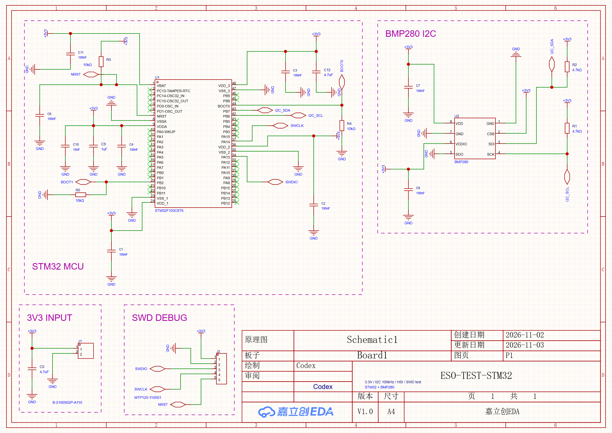

# STM32 + BMP280 实际效果

此 PNG 是真实测试工程保存并重开后由 EasyEDA 原生导出的图纸，未通过图片编辑重绘。
STM32F103C8T6 + BMP280，外部稳压3.3V、I²C目标100kHz、内部HSI时钟及SWD。
共21件器件、97物理脚、32明确NC、17个要求实体相连的引脚组；4个功能模块。

该版本严格 gate 各阶段通过，原生报告零错误/零警告；完成逐脚对账、文字/模块审查、
显式保存与真实重开回读。图面仍有个别很小的文字/标记间距，不能据零告警称布局最优。
不含私有UUID、原始工程或运行日志；图片中测试工程名称作为此次公开效果展示保留。

本图是局部修复后的下层 typed 链成果，不是 ESO 标准全自动生成的证明。早期17件器件/
197条文字数据通过采集适配回放；明确允许外围旋转后，修复构建可生成四个合法局部模块。
其中 MCU 框约990×775 raw，仍无法通过原图框扣除图签后的装箱检查，保持未完成。
未执行硬件、固件、PCB或仿真功能验收。
