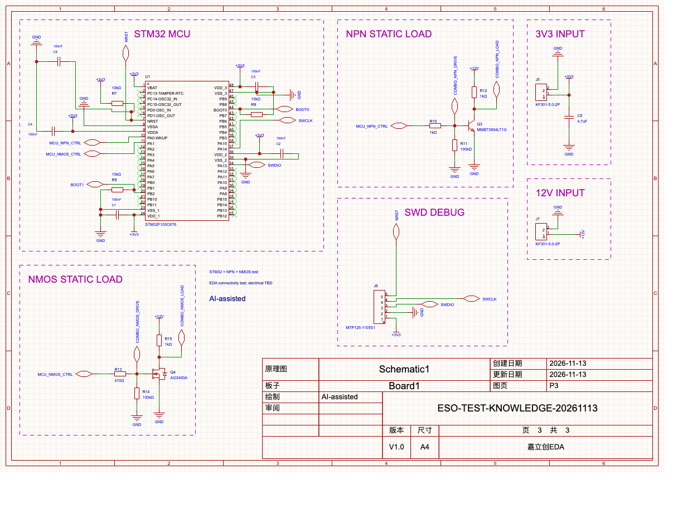
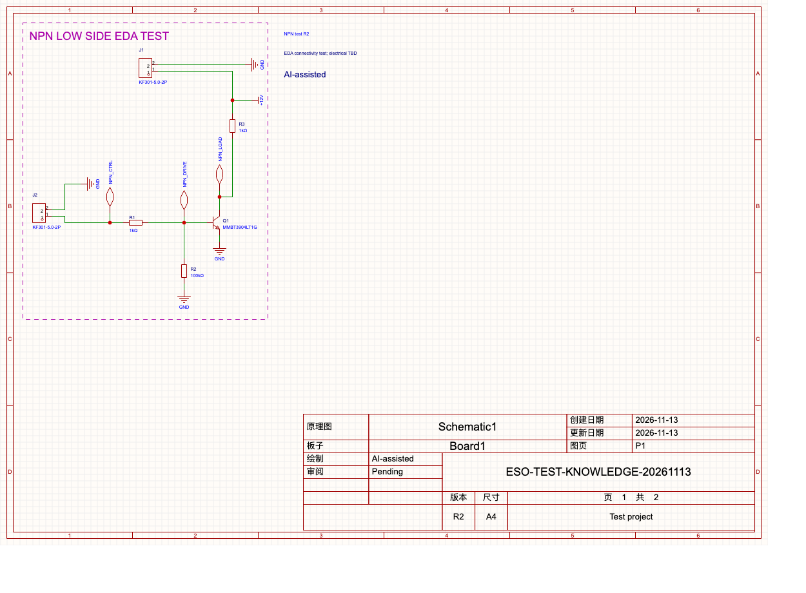
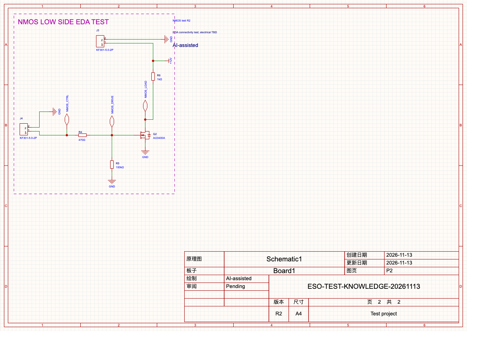
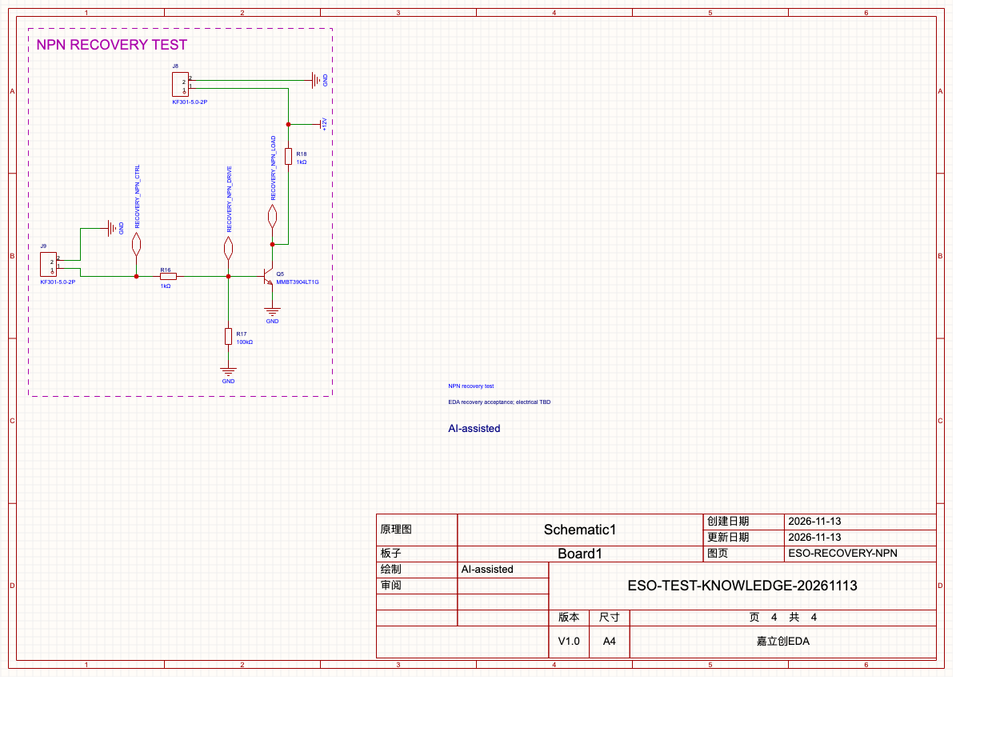
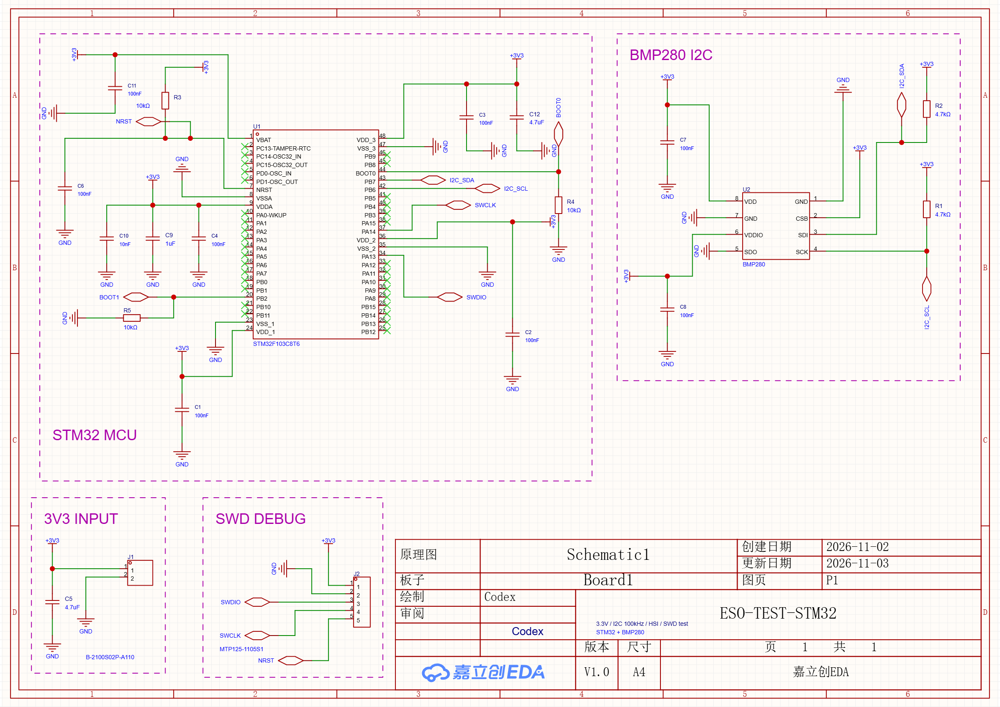

# EDA 效果图库

本次新增四张真实历史测试图纸，导出日期为 2026-11-13。
PNG 来自保存重开后的原生 SVG 预览，保留当时的图纸内容、图签与测试工程名称。
公开文件与私有验收预览按字节一致，来源关联与原始证据保存在私有运行目录。
2026-11-14 的图面复审发现旧审阅偏松。0.5.2 新规则已拒绝 MCU 图的两处同网交叉与
NMOS 图的三行文字穿框，图纸仍需按新规范修订。阅读顺序、外围归属、标签方向和页面留白
也纳入逐项审阅，问题与后续检查见[可读性复盘](../../references/live-recovery.md#图面可读性复盘)。

## STM32 与 NPN、NMOS 双支路

STM32F103C8T6 最小系统使用外部稳定 3.3V、内部时钟与 SWD，PA0、PA1 分别连接
MMBT3904LT1G、AO3400A 静态低侧开关，两支路各有独立下拉及 12V 电阻负载。
共 21 件器件、93 个物理脚、32 个 NC，按 MCU、开关、电源接口与调试接口分区。

保存重开、身份与逐脚网络、原生严格 DRC、补充几何与图面审阅通过。
以上为当时的验收记录。当前复审发现 NRST 相关走线及右上 GND 支路各一处无接点同网交叉，
新检查返回失败；模块阅读顺序与局部外围也待重排。
宿主依据实测修订布局并恢复文字，报告保留失败历史和修订过程。
电气依据中的关断、温度与散热仍有缺项，仿真及实物性能待按项目验证。[组合验收记录](../plans/mcu-switch-eda-acceptance.md)

## NPN 低侧开关

MMBT3904LT1G，12V 名义电源、外部 0/3.3V 控制，1kΩ 负载、1kΩ 基极串联电阻和
100kΩ 下拉，配两个独立两针端子，共 6 件器件、13 个物理脚。
R2 图纸经文字修正后重新保存、重开和检查，连接及图面验收通过。
图签保留导出时的 `Pending` 字样，实际审阅结果见关联报告。电气性能待验证。[开关验收记录](../plans/npn-nmos-eda-acceptance.md)

## NMOS 低侧开关

AO3400A，12V 名义电源、外部 0/3.3V 控制，1kΩ 负载、470Ω 栅极串联电阻和
100kΩ 下拉，配两个独立两针端子，共 6 件器件、13 个物理脚。
R2 图纸经文字修正后重新保存、重开和检查，连接及图面验收通过。
图签保留导出时的 `Pending` 字样，实际审阅结果见关联报告。电气性能待验证。[开关验收记录](../plans/npn-nmos-eda-acceptance.md)

本次复审确认模块框右边穿过测试标题、测试说明与 `AI-assisted` 三行文字，当前新检查返回失败。

## 缺件恢复测试

独立 NPN 测试页采用 Q5、R16–R18、J8/J9。受控中断后回读状态，保留 1 件已有实例，
补放 5 件缺失器件，随后完成连接、文字调整、保存重开与逐脚回读。
最终 6 件器件、13 个物理脚，核心、几何和图面证据索引完整，原有测试页保持一致。
该图用于展示恢复后的 EDA 结果，电气性能待验证。[恢复验收记录](../plans/recovery-live-acceptance.md)

## 早期 STM32 与 BMP280

此 PNG 是真实测试工程保存并重开后由 EasyEDA 原生导出的图纸，未通过图片编辑重绘。
STM32F103C8T6 + BMP280，外部稳压3.3V、I²C目标100kHz、内部HSI时钟及SWD。
共21件器件、97物理脚、32明确NC、17个要求实体相连的引脚组；4个功能模块。

该版本严格 gate 各阶段通过，原生报告零错误/零警告；完成逐脚对账、文字/模块审查、
显式保存与真实重开回读。图面仍有个别很小的文字/标记间距，不能据零告警称布局最优。
不含私有UUID、原始工程或运行日志；图片中测试工程名称作为此次公开效果展示保留。

本图是局部修复后的下层 typed 链成果，不是 ESO 标准全自动生成的证明。早期17件器件/
197条文字数据通过采集适配回放；明确允许外围旋转后，修复构建可生成四个合法局部模块。
其中 MCU 框约990×775 raw，仍无法通过原图框扣除图签后的装箱检查，保持未完成。
未执行硬件、固件、PCB或仿真功能验收。
